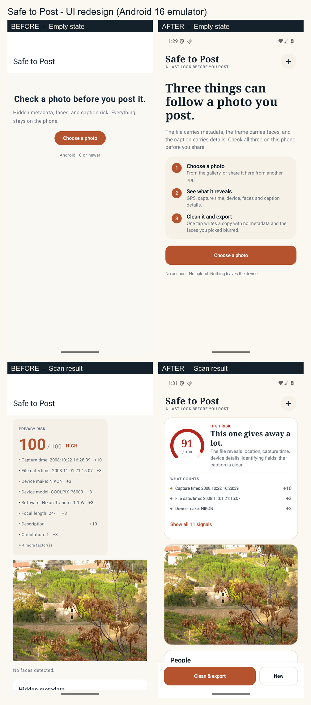
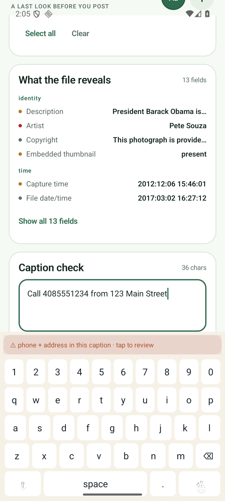

# Safe to Post

An Android app that checks a photo before you post it — and helps you remove what it would give away.
Built as the implementation component of our CSCI 180 Computer Security group project,
*Behind the Default Settings: How Social Networks Collect, Track, and Expose User Data*.

> **Status:** v0.9.0 debug build (Android 10+). Everything runs on the phone: no account,
> no upload, no analytics.



## The project in one paragraph

Social platforms ship privacy settings that most people never touch, and a photo carries
more than its pixels. This app applies the project's defensive question — *if a user installs
an app and never opens the settings menu, how much can other people see?* — to the moment of
posting: it surfaces hidden metadata, detects faces, checks the caption, explains a 0–100 risk
score, and writes a cleaned copy with the details removed.

**Team:** Connor Toreson · Tianbin Liu (implementation) · Jason Zhou.
CSCI 180 · Computer Security · Fall 2026.

## What it does

1. **Reads the hidden data inside a photo.** JPEG segments, EXIF and a custom TIFF GPS reader:
   GPS, capture time, device make/model, software, lens, thumbnail, author fields. Location is
   listed first and each field carries a risk dot. One tap writes a copy with no metadata.
2. **Finds faces and blurs the ones you pick.** ML Kit (bundled, on-device) draws the detected
   regions; choose faces, export a mosaicked copy.
3. **Checks the caption and scores the post.** Phone, e-mail, street address, date, school/work,
   handle and link patterns are highlighted; the score is the sum of the listed factors, so every
   point can be explained.
4. **Cleans the caption.** `[phone]`, `[address]`, ... replace the findings; the app offers Undo,
   the keyboard rewrites the focused field directly.
5. **Batch mode.** Up to 12 photos, thumbnail + score + field count per row, uncheck to skip,
   per-row Clean, optional "Blur all faces" before the metadata-free export.
6. **Keyboard (IME).** A minimal QWERTY with a caption-risk strip: reads only the focused text
   field, shows what it found, offers Clean/Undo, and hands the caption back to the app.



## Install (test build)

1. On an Android phone (Android 10 / API 29 or newer) open
   [Releases → v0.9.0](https://github.com/TianbinLiu/SafeToPost/releases/tag/v0.9.0) and install
   `SafeToPost-0.9.0.apk`.
2. Allow install from the browser; Play Protect may warn — expected for a debug build.
3. On first launch grant `ACCESS_MEDIA_LOCATION` if you want the GPS rows (Android's photo
   picker otherwise hands the app a redacted copy). Everything else works without it.

Optional keyboard: Settings → System → Languages & input → On-screen keyboard → Manage keyboards
→ enable **Safe to Post keyboard**, then switch with the keyboard switcher. The keyboard sees only
the focused text field, never images or other apps.

## Build from source

Requirements: JDK 17, Android SDK 36, Android Studio or the command-line SDK.

```bash
./gradlew assembleDebug          # Windows: gradlew.bat assembleDebug
adb install -r app/build/outputs/apk/debug/app-debug.apk
```

`local.properties` (SDK path) is generated by Android Studio and not committed. The debug build is
the demo build: no API key, backend, or network configuration.

## How it works

```
photo picker / share sheet ──► PhotoFiles ──► original bytes + bitmap
        │                          │
        │                          ├──► MetadataReader (JPEG segments + EXIF + GPS TIFF) ──► PhotoMetadata ─┐
        │                          │                                                                        │
        │                          └──► FaceFinder (ML Kit) ──► FaceRegion ─────────────────────────────────┼──► RiskScorer ──► RiskScore (0–100)
        │                                                                                                   │
        └──► CaptionScanner ──► CaptionFinding ───────────────────────────────────────────────────────────┘

selected faces ──► FaceBlur ──► MetadataStripper (re-encode) ──► GalleryExport ──► Pictures/Safe to Post
```

| Package | Responsibility |
|---|---|
| `metadata` | JPEG segment walking, EXIF parsing, custom GPS IFD reader, field catalog and per-field risk |
| `photo` | Original bytes, decoding, face detection, mosaic blur, metadata stripping, MediaStore export |
| `caption` | Rule-based caption scan, findings, placeholder cleaning |
| `risk` | Factor weights, 0–100 aggregation, levels |
| `ui` | Compose screens: verdict card, evidence cards, batch, themes, keyboard |
| `ScanViewModel` | State, pipeline orchestration, batch and export |

## Documentation

| Document | What is in it |
|---|---|
| [Code documentation (PDF)](docs/SafeToPost_Code_Documentation.pdf) · [DOCX](docs/SafeToPost_Code_Documentation.docx) | Final submission version (v0.9.0): project description, per-module code, build/run, reproduction, limitations, references |
| [ARCHITECTURE.md](docs/ARCHITECTURE.md) | Module map and pipeline |
| [PRIVACY.md](docs/PRIVACY.md) | Data-flow and permission notes |
| [MARKET_ANALYSIS.md](docs/MARKET_ANALYSIS.md) | Comparable products and follow-up opportunities |
| [IME_FEASIBILITY.md](docs/IME_FEASIBILITY.md) | What a keyboard can and cannot check, and the prototype in this repo |
| [DEMO_SCRIPT.md](docs/DEMO_SCRIPT.md) | 15-minute presentation script, video slide steps, fallbacks |
| [DEFENSE_NOTES.md](docs/DEFENSE_NOTES.md) | Anticipated questions with short answers and key numbers |
| [SUBMISSION_CHECKLIST.md](docs/SUBMISSION_CHECKLIST.md) | What to submit, where it lives, and the pre-class checks |

## Repository map

- `app/` — Android application (Kotlin, Compose, Gradle module)
- `docs/` — architecture, privacy, code documentation (PDF/DOCX), market/IME studies, demo and defense notes
- `docs/images/` — screenshots used in this README and the demo script
- `Releases` — `v0.1.0` (original test build), `v0.1.0-rebuild`, then feature releases up to `v0.9.0`

## Known limitations

- Android only; the iOS port was deliberately left out of scope.
- Metadata reader focuses on JPEG/EXIF; HEIC/PNG text chunks fall into "other" (removed on export,
  not explained field by field). Video is out of scope.
- Caption scanner is rule-based: misses paraphrases and can flag harmless dates. No NER/LLM yet.
- Face detection can miss profile views and heavy occlusion; the blur is a fixed-strength mosaic.
- The risk score is a prioritisation aid, not a guarantee.
- The keyboard prototype has no prediction/autocorrect and only reads the focused text field.

## Version history

- **0.9.0** — optional "Blur all faces" in batch mode.
- **0.8.0** — batch thumbnails, uncheck-to-skip, per-row cleaning.
- **0.7.0** — keyboard Undo (30 snapshots).
- **0.6.0** — batch metadata cleaning (up to 12 photos).
- **0.5.0** — Clean caption with placeholders and Undo, in app and keyboard.
- **0.4.0** — caption-guard IME with handoff to the app.
- **0.3.0** — four palettes with a wavy switch, persisted.
- **0.2.0** — redesigned UI, share-sheet intake, share-on-export.
- **0.1.0** — first rebuilt APK (metadata, faces, caption score, export).

## License / use

Course project, not distributed on Google Play. Third-party libraries keep their own licenses
(AndroidX, Google ML Kit). The sample photos used during testing are public test images and are
not committed to this repository.
